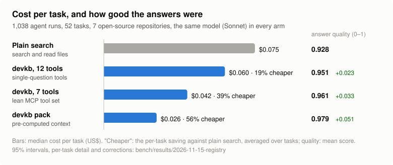

# devkb

**A knowledge graph of your repository for software development agents.** Agents answer "what calls this, what breaks, which tests"
in one step instead of searching file by file: 56% cheaper, with better answers.

<picture>
  <source media="(prefers-color-scheme: dark)" srcset="docs/img/benchmark-dark.svg">
  
</picture>

## 1. What devkb is

- **A graph** built from your source and git history: functions, calls, tests, routes, errors, configuration,
  commits, pull requests, tickets ([ontology](devkb/ontology.md)).
- **Packs**: one command answers a whole question (who calls this, what breaks, which tests to run), each item with
  the source line that proves it, and a statement of what the graph could not see.
- **An MCP server** giving agents the same answers as tools, for Claude Code, Codex and any MCP client.

Everything runs locally: devkb reads files and runs `git`, never your code (unless `devkb.json` opts in), and the graph never leaves your machine.

### Languages

| Language | Status | What devkb understands |
|---|---|---|
| Python | ✅ Supported | functions, classes, calls (through imports, re-exports, typed objects, base classes), tests, FastAPI/Flask routes, raised and logged errors, environment variables; every pack |
| TypeScript, TSX | 🟡 Partial | functions, components, classes, and the HTTP calls they make to backend routes; not calls between them |
| JavaScript (`.js`, `.mjs`) | 🟡 Partial | as TypeScript |
| Odoo XML | 🟡 Partial | templates and menus |
| Bash / shell | ⬜ Not yet | files and history only |
| C, C++, Java, Rust, Go, C#, others | ⬜ Not yet | files and history only |

"Files and history" is the language-independent layer every repository gets: files, commits, pull requests and
tickets.

## 2. How much it saves

Same model, same tasks, answers scored against truth computed from the source. Saving of a devkb pack against plain
search, by kind of task:

| Task | Saving | Quality |
|---|---|---|
| An error message → the route handlers that reach it | **77%** | +0.075 |
| A change → the route handlers it affects, the tests to run | **66%** | +0.088 |
| An error in a command-line tool → every function on its path | **60%** | +0.172 |
| A signature change → the files that call it (one hop) | 21% | +0.007 |

The saving is in call chains; on one-hop questions plain search is already good. An earlier pre-registered study (30
held-out tasks, 1,020 runs, two model sizes) found packs 41% cheaper and the lean tools 35% ([`study/`](study/),
`make verify` recomputes it). Per-repository results and corrections:
[`bench/results/2026-11-15-registry`](bench/results/2026-11-15-registry/); add a repository:
[`docs/BENCHMARK.md`](docs/BENCHMARK.md).

## 3. Set up

```bash
pip install "devkb[mcp] @ git+https://github.com/namiq-ai/devkb"
cd your-repo
devkb init --hooks
```

This builds the graph into `.devkb/`, adds a short devkb section to `AGENTS.md` and `CLAUDE.md`, registers the MCP
server in `.mcp.json`, and rebuilds the graph after each commit. Your own content in those files is kept;
`devkb init --remove` undoes it.

Ask it directly:

```bash
devkb pack --project . refactor my_function     # who calls it, which tests
devkb pack --project . error "message text"     # which route handlers reach it
devkb pack --project . file path/to/file.py     # before editing a file
```

For Codex, add to `~/.codex/config.toml`:

```toml
[mcp_servers.devkb]
command = "devkb"
args = ["mcp", "--project", ".", "--toolset", "dev"]
```

## 4. Licence and citation

Pre-release. The licence will be chosen before the repository is made public; until then, all rights reserved.
Releases: [`docs/RELEASING.md`](docs/RELEASING.md).

> Hung T. Le. *Fewer Turns, Not a Better Graph: A Pre-Registered Study of Process Graphs for Coding Agents.* 2026.
